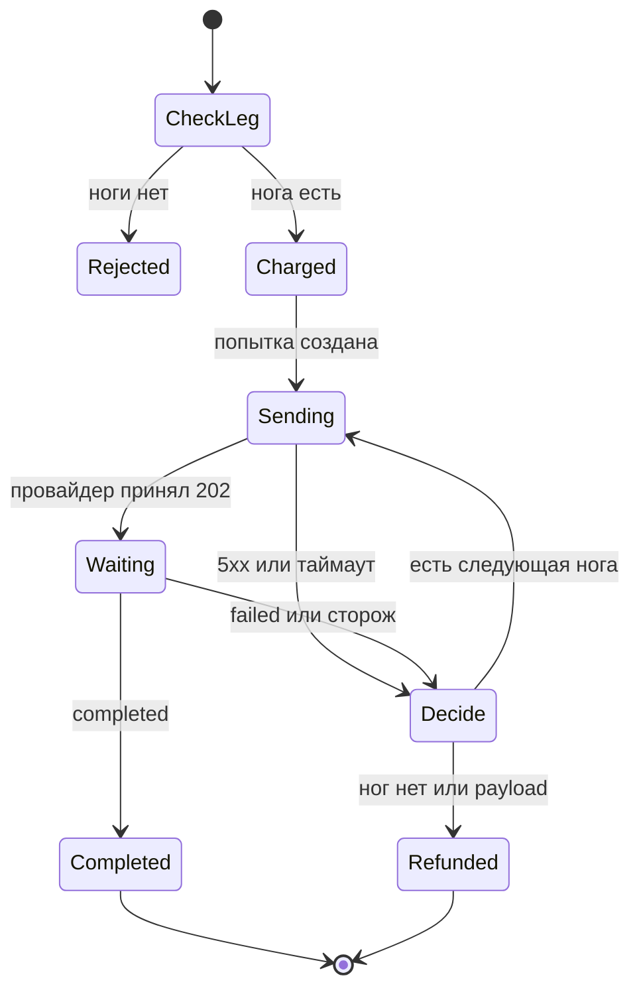

# Архитектура сервиса генерации

Документ описывает, как устроен сервис и почему каждое решение такое. Операционная инструкция — в [README.md](README.md).

## Что строим

Сервис принимает заказ на генерацию, списывает токены и отдаёт задачу цепочке провайдеров. Провайдер отказал — идём на следующую ногу. Отказали все — возвращаем токены. Начисление и возврат происходят ровно один раз, даже если вебхук пришёл двадцатью параллельными запросами и даже если сервис запущен в четырёх процессах.

Рядом живут два фейковых провайдера, `alpha` и `beta`. Это один процесс с двумя именами: настоящая генерация и настоящие деньги здесь не нужны, нужна управляемая неисправность.

## Жизненный цикл задачи

Пять шагов и одно решение.

1. Подбираем ногу, которая принимает столько референсов, сколько прислал пользователь. Подходящей нет — `400`, журнал не трогаем.
2. В одной транзакции создаём задачу и списываем цену строкой журнала.
3. Отправляем попытку текущему провайдеру.
4. Ждём вебхук. Молчание дольше `PROVIDER_TIMEOUT` подбирает сторож.
5. Одно и то же решение принимает и вебхук, и синхронная ошибка отправки, и сторож:
   - `completed` — задача завершена, в ней ссылка, возврата нет;
   - `payload` — задача сразу `failed`, один возврат: кривое тело отвергнет любая нога;
   - `technical`, `moderation` или тишина сторожа — следующая подходящая нога;
   - ног больше нет — `failed` и один возврат.

`moderation` не ведёт на ногу с `skip_on_moderation`. Сторож для маршрута равен отказу `technical`: по правилам задания он идёт туда же, куда отказ в вебхуке.



Поздний `completed` после того, как попытку уже закрыли, в этот автомат не возвращает. Он остаётся пометкой на старой попытке.

## Почему состояние лежит в PostgreSQL

Сервис обязан работать как `uvicorn --workers 4`. Память процесса для этого не подходит: у каждого воркера она своя, и четыре сторожа четыре раза вернули бы одни и те же токены.

Общая точка — база. Воркеры не выбирают лидера и не держат расписание у себя. Кто успел забрать строку, тот её и ведёт.

## Схема и инварианты

Миграция `alembic/versions/20261021_0001_initial.py` создаёт каталог и ограничения. ORM схему не создаёт.

### Журнал — единственное движение денег

Таблица `users.balance` сама по себе ничего не решает. Баланс меняет триггер `AFTER INSERT` на `ledger_entries`: прибавил сумму строки к пользователю и записал `balance_after`.

Отсюда три свойства.

- Операции без строки журнала нет: другого пути к `balance` в коде нет.
- Строка и баланс коммитятся вместе. Подтверждённый снимок не бывает «деньги ушли, строки нет».
- `CHECK (balance >= 0)` не даёт уйти в минус, даже если проверка в приложении ошибётся.
- `UNIQUE (idempotency_key)` не даёт вставить ту же операцию второй раз.

Ключи фиксированные:

| Событие | Ключ |
| --- | --- |
| Списание за задачу | `charge:{task_id}` |
| Возврат за задачу | `refund:{task_id}` |
| Оплата | `payment:{payment_id}` |

Повторная вставка с тем же ключом не добавляет строку, триггер не стреляет, баланс стоит.

`AFTER INSERT`, а не `BEFORE`, выбран сознательно. У `INSERT ... ON CONFLICT DO NOTHING` строковый `BEFORE`-триггер в PostgreSQL выполняется даже для отброшенной строки и успел бы начислить деньги вхолостую. `AFTER INSERT` срабатывает только по строке, которая реально легла.

Оплата дополнительно проходит через таблицу `payments` с первичным ключом `payment_id`. Из двадцати одинаковых вставок возвращается одна. Только победитель, и только при `status = succeeded`, пишет строку `topup`.

### Задача и попытка

`tasks.status`: `dispatching`, `waiting`, `completed`, `failed`.

Активная задача — `dispatching` или `waiting`. Лимит три считается под `SELECT ... FOR UPDATE` по пользователю, поэтому четвёртый параллельный `POST /generate` видит уже вставленные строки и получает `429`.

`attempts.status`: `sending`, `waiting`, `succeeded`, `failed`, `timed_out`.

Частичный уникальный индекс разрешает задаче только одну попытку в `sending` или `waiting`. Два воркера не могут одновременно считать себя отправителями одной задачи.

История попыток не переписывается. Следующая нога — новая строка.

## Одна функция решения

`app/orchestrator.py`, функция `settle_attempt`. Её вызывают:

- `POST /webhooks/providers/{name}`;
- синхронный обрыв `POST /tasks` (сеть, таймаут клиента, `5xx`, `4xx`);
- сторож.

Внутри одна транзакция и один порядок блокировок: сначала строка задачи, потом строка попытки. Вебхук и сторож, пришедшие в один момент, выстраиваются в очередь на этой строке. Второй видит уже закрытую попытку.

Дальше развилка такая:

- попытка всё ещё текущая и открытая, пришёл `completed` — задача `completed`, пишем `result_url`, журнал не трогаем;
- то же, но `payload` — закрываем попытку и делаем единственный возврат;
- то же, но `technical` / `moderation` / сторож — закрываем попытку и либо открываем следующую, либо возвращаем токены;
- попытка уже не текущая или задача уже в терминальном статусе — исход задачи не меняем.

Возврат — это вставка `refund:{task_id}` в той же транзакции, где статус становится `failed`. Десять параллельных `failed` на последней ноге дают одну вставку.

`4xx` от провайдера трактуем как `payload`: провайдер говорит, что тело неправильное, следующая нога его тоже отвергнет. `5xx` и таймаут клиента — `technical`, идём дальше.

## Отправка и падение между коммитами

Провайдера нельзя вызывать, держа блокировку строки: его таймаут остановил бы и вебхуки, и сторожа.

Поэтому так:

1. Короткая транзакция. Списание, задача, попытка в статусе `sending`. Коммит.
2. Условный захват `dispatch_token`. Его ставит один процесс. Второй видит токен и не шлёт повторный `POST /tasks`.
3. HTTP вне транзакции.
4. Короткая транзакция. `202` переводит попытку в `waiting` и ставит `deadline_at = now + PROVIDER_TIMEOUT`. Ответ `5xx` или таймаут клиента уходит в `settle_attempt`.

Попытка создаётся до HTTP. Это исходящий ящик: строка помнит, что отправку надо довести, даже если процесс умер.

Если процесс умер после коммита `sending` и до ответа клиенту, клиент мог не получить `task_id`. Задача при этом уже списана и лежит в базе. Сторож через `DISPATCH_GRACE_SECONDS` считает зависший `sending` техническим отказом и либо идёт на следующую ногу, либо возвращает токены. Одну и ту же ногу заново не вызываем: мы не знаем, успел ли провайдер принять запрос. Поздний вебхук по этой попытке обрабатывается как опоздавший.

Неравенство `DISPATCH_GRACE_SECONDS > PROVIDER_HTTP_TIMEOUT` проверяется на старте. Иначе сторож оборвал бы ещё живой HTTP-вызов.

## Сторож в каждом процессе

В lifespan каждого воркера крутится цикл раз в секунду. Он не хранит список задач.

```sql
SELECT ...
FROM tasks t
JOIN attempts a ON a.id = t.current_attempt_id
WHERE срок попытки вышел
ORDER BY t.updated_at
FOR UPDATE OF t SKIP LOCKED
LIMIT 1
```

`SKIP LOCKED` отдаёт строку одному воркеру. Остальные три её не видят и берут другую либо ничего. Упал воркер посреди транзакции — PostgreSQL снимает блокировку сам, строку подберёт следующий цикл. Отдельный процесс-лидер не нужен: если бы лидер был один, его смерть останавливала бы все таймауты до перевыборов.

Сторож вызывает тот же `settle_attempt` с причиной `watchdog`. В истории такая попытка лежит как `timed_out` / `technical`.

## Правило 6

Поздний `completed` после того, как сторож уже сдал попытку, не должен дать задаче и результат, и возврат.

Выбранное поведение: **возврат остаётся, результат опоздавшей попытки в задачу не записывается.**

Сторож в той же транзакции помечает попытку `timed_out` и либо открывает следующую ногу, либо ставит `failed` и вставляет единственный `refund`. Вебхук, пришедший после этого, берёт ту же блокировку задачи, видит, что попытка уже не открыта, и делает только одно: пишет ссылку в `attempts.late_result_url` и время в `late_received_at`. `tasks.result_url` и журнал он не трогает.

Почему оставляем возврат, а не забираем его назад и не выдаём файл:

- Пользователь уже мог увидеть возврат и потратить токены. Обратное списание догоняло бы новые заказы.
- Если сторож успел уйти на следующую ногу, поздний файл первой ноги спорит со второй. Вторая может упасть и вызвать возврат — снова результат вместе с возвратом.
- Терминальное денежное состояние липкое. Его проще защитить уникальным ключом, чем проводить компенсацию компенсации.

Опоздавший файл не выбрасывается молча: он виден в истории попытки. Это и есть доказательство для теста, что вебхук дошёл и был проигнорирован как исход задачи.

Если `completed` пришёл, пока попытка ещё `sending` или `waiting`, это обычный успех. «Поздно» начинается в момент, когда попытку закрыл сторож или смена ноги, а не по настенным часам.

## Фейковые провайдеры

`providers/main.py` — один процесс, маршруты `/alpha` и `/beta`.

`POST /{name}/tasks` сразу отвечает `202 {"external_id": "..."}`. Исход вебхука замораживается в этот момент, оба дубля несут одно и то же тело. Подпись `X-Signature` — hex HMAC-SHA256 сырых байт, секрет общий с сервисом (`WEBHOOK_SECRET`). В тело кладётся `attempt_id`, который сервис прислал сам: вебхук можно склеить с попыткой, даже если процесс умер раньше, чем записал `external_id`.

Поведение меняется `PUT /{name}/settings`, чтобы тесты включали его адресно:

- `fail_rate` и `error_type`;
- `sync_mode`: `ok`, `503`, `timeout`;
- `webhook_count`: `0` — тишина, `2` — повтор;
- `duplicate_mode`: `sequential` или `concurrent`;
- `webhook_delay_seconds`: явное значение в тестах, а по умолчанию случайные 2–20 секунд, как в условии.

Настройки лежат в памяти этого одного процесса. Для двойника провайдера это нормально. Для сервиса генерации так нельзя, и там так не сделано.

## Что увидит читатель API

| Метод | Смысл |
| --- | --- |
| `POST /generate` | Проверка ноги, списание, отправка на первую ногу, `{task_id}` |
| `POST /webhooks/providers/{name}` | Подписанный исход провайдера |
| `POST /webhooks/payments` | Подписанная оплата. Повтор того же `payment_id` — второе начисление невозможно |
| `GET /tasks/{id}` | Статус, текущая нога, история попыток |
| `GET /users/{id}/balance` | Баланс и последние строки журнала |

Пользователя отдельно регистрировать не нужно. Первая оплата создаёт его с нулём и тут же проводит `topup`. `POST /generate` по неизвестному или пустому балансу отвечает `402`, не создавая задачу.

Каталог стартовый, он в миграции:

| Модель | Цена | Ноги |
| --- | --- | --- |
| `image-fast` | 2 | `alpha` до 4, затем `beta` до 10 |
| `video-long` | 25 | `beta` до 2, затем `alpha` до 1 с `skip_on_moderation` |

## Как добавляется следующая миграция

Текущая схема — ревизия `0001_initial`. Следующая не правит её, а ложится сверху:

```bash
alembic revision -m "add generation kind"
```

В новом файле — `upgrade` и `downgrade`. Накат на чистую базу и на уже поднятую один и тот же: `alembic upgrade head`. Контейнер делает это сам, до того как поднимет воркеры. Четыре воркера миграцию не запускают и не гоняются за ней.

## Порядок сборки

Так репозиторий и собирался, этот же порядок читается в истории коммитов.

1. Схема и compose. Сначала инварианты, которые нельзя обойти кодом: уникальный ключ журнала, триггер баланса, одна открытая попытка, блокировка сторожа.
2. Оркестрация. Все входы сведены в `settle_attempt`, отправка вынесена из транзакции, захват попытки условный.
3. Провайдеры. Неисправности включаются снаружи, чтобы тесты проверяли сервис, а не моки в его процессе.
4. Тесты на настоящую базу из compose: одна оплата из двадцати, один возврат из десяти, фолбэк на вторую ногу, поздний `completed` после сторожа.
5. README с запуском и ответами на четыре вопроса условия: ровно один раз, падение посреди вебхука, правило 6, миграции.
